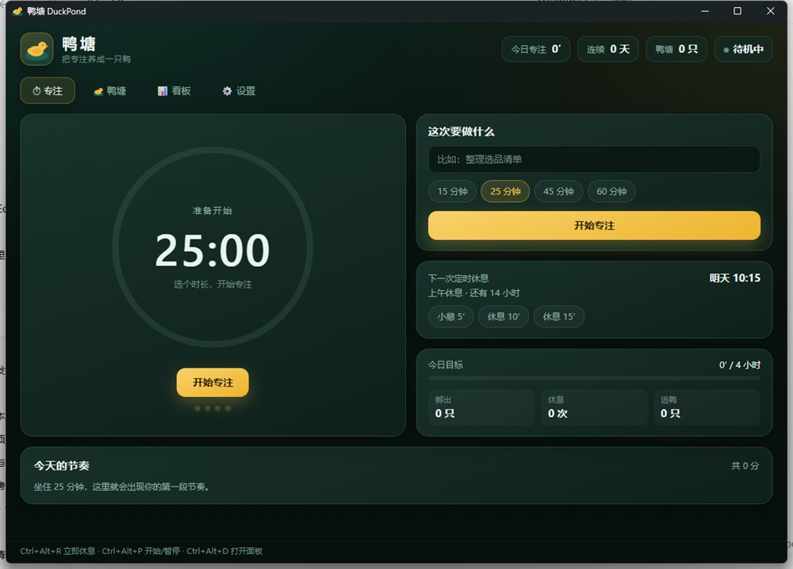
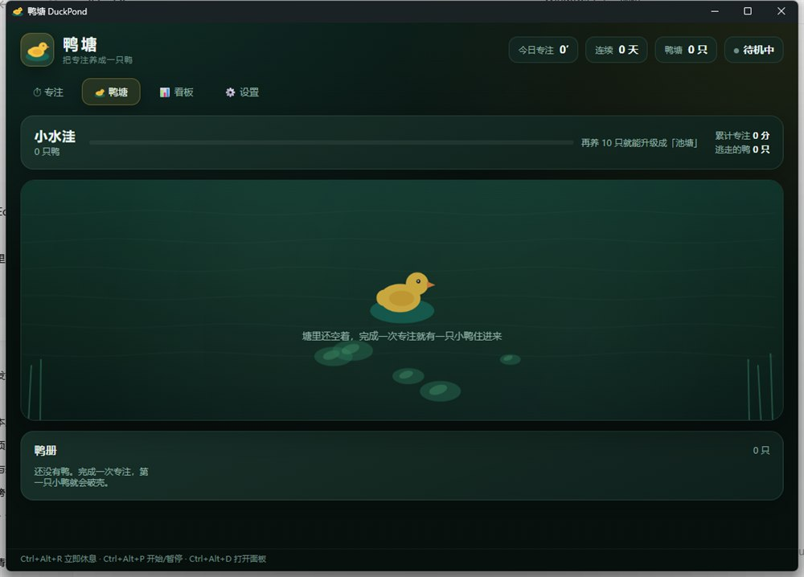
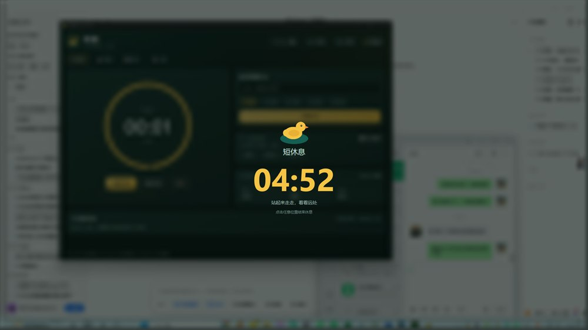
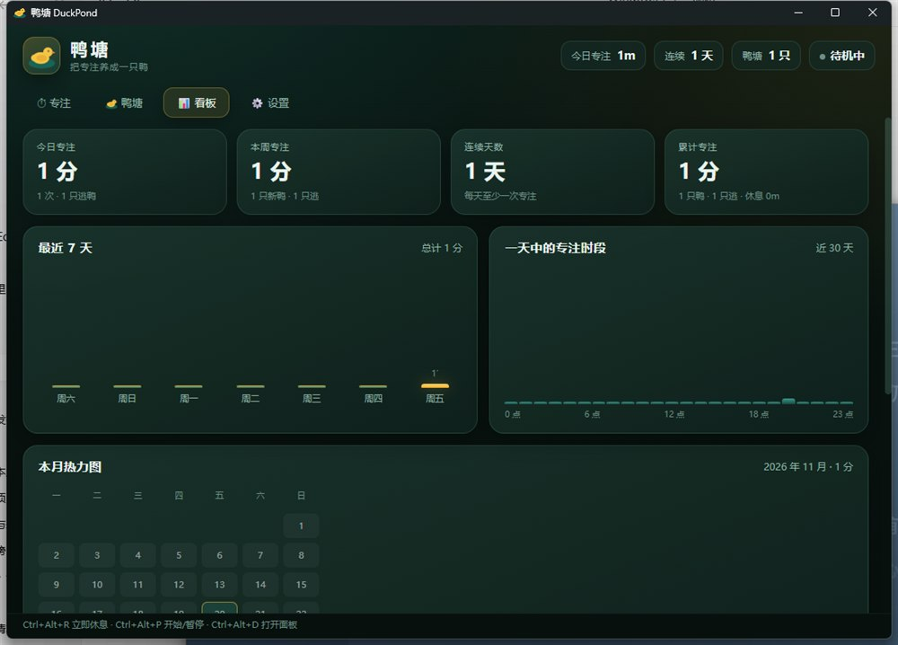

# 🦆 鸭塘 DuckPond

一个 Windows 上的自律小工具：**定时提醒休息 + 番茄钟 + 桌面模糊遮罩 + 鸭子养成 + 周/月看板**。

灵感来自 Forest 的养成玩法与 fadetop 的模糊遮罩，把「树」换成了「鸭子」，给自己攒一个越养越大的鸭塘。



## ✨ 功能

| 模块 | 说明 |
|---|---|
| ⏰ 定时休息 | 每天 / 每周指定几天 / 仅一次 / 每隔 N 分钟；到点弹全屏模糊遮罩，例如「每天 10:15 休息 10 分钟」 |
| 🍅 番茄钟 | 专注 25 / 短休 5 / 长休 15（可改），自动接续；按真实时间计时，最小化也照走 |
| 🌫 模糊遮罩 | 实时抓屏 → 强模糊 + 压暗，全屏盖住任务栏；点击或 ESC 可提前退出，跳出会被记录 |
| 🦆 鸭塘养成 | 完成专注孵出小鸭，按累计专注从鸭苗长到成年；8 种鸭型；中断会留下灰色鸭影；鸭子数量决定塘的等级 |
| 📊 看板 | 今日 / 本周 / 累计 / 连续天数、7 日柱状、24 小时分布、月热力图、10 个成就 |
| 🖼 打卡导出 | 一键生成 1000×1400 PNG 打卡图，含数据卡与本月汇总 |
| ⌨ 快捷键 | `Ctrl+Alt+R` 立刻休息 5 分钟、`Ctrl+Alt+P` 开始/暂停、`Ctrl+Alt+D` 打开面板 |
| 📥 托盘常驻 | 关闭窗口只是收进托盘；开机自启；单实例唤醒 |



## 🌫 遮罩效果



## 📊 看板



## 🚀 快速开始

**方式一：直接用发布包（推荐自用）**

1. 到 Releases 下载 `鸭塘-DuckPond-win64.zip`（仓库里没有附件时，用方式二自己打一个）
2. 解压到任意固定目录（例如 `D:\Tools\鸭塘`）
3. 双击 `DuckPond.exe`

发布包是 self-contained，机器上不需要装 .NET；但需要系统已有 **WebView2 Runtime**（Win10/11 一般自带，缺失时从微软官网装 Evergreen Runtime）。

**方式二：自己构建**

```powershell
git clone https://github.com/soapyz/duckpond.git
cd duckpond
.\scripts\build.ps1        # 产出 dist\ 和 鸭塘-DuckPond-win64.zip
```

或手动：

```powershell
dotnet publish -c Release -r win-x64 --self-contained true -o .\dist
```

要求：.NET 10 SDK、Windows 10/11。NuGet 直连慢时项目里已带 `nuget.config`（华为云镜像）。

## ⌨️ 快捷键 & 托盘

| 操作 | 效果 |
|---|---|
| `Ctrl+Alt+R` | 立即休息 5 分钟（弹遮罩） |
| `Ctrl+Alt+P` | 开始 / 暂停专注 |
| `Ctrl+Alt+D` | 打开 / 收起面板 |
| 托盘右键 | 打开面板、开始专注、休息 5 分钟、暂停提醒、开机自启、退出 |

## 💾 数据在哪

| 内容 | 路径 |
|---|---|
| 数据 | `%AppData%\DuckPond\data.json` |
| 每日备份（保留 14 份） | `%AppData%\DuckPond\backups\` |
| 导出的打卡图 | `%AppData%\DuckPond\exports\` |
| WebView2 缓存 | `%AppData%\DuckPond\WebView2\` |

全部本地存储，不联网、不上传。写入采用「临时文件 + 原子替换」，崩溃不会写坏原数据。

## 🧱 技术栈

- **壳**：WPF（.NET 10，`net10.0-windows`），单实例 + 托盘 + 全局热键 + 遮罩窗
- **界面**：WebView2 承载 `wwwroot` 里的 HTML/CSS/JS，虚拟主机 `https://duckpond.local`
- **数据**：本地 JSON（`System.Text.Json`），无数据库依赖
- **鸭塘画布**：`wwwroot/duck.js` 纯 Canvas 绘制，含游动、反弹、鸭型装扮、水波
- **遮罩**：`UI/ScreenBlur.cs` 抓屏 → 1/14 降采样 → 位移叠加模糊 → 放大 + 压暗

## 📁 目录结构

```
DuckPond/
├─ App.xaml(.cs)        单实例、异常日志、--autostart 静默启动
├─ Core/                数据模型、番茄钟引擎、定时规则、统计、鸭子、协调器
├─ Sys/Platform.cs      自启、全屏检测、全局热键
├─ UI/                  MainWindow(WebView2)、OverlayWindow、ToastWindow、托盘、抓屏模糊
├─ wwwroot/             index.html / styles.css / app.js / duck.js / duck.png
├─ Assets/              图标
└─ tools/ui-probe.ps1   开发期 GUI 截图与点击探针
```

## ⚠️ 已知边界

- 遮罩目前只覆盖**单显示器**，多屏需自行扩展
- 刻意保留「点击可退出」，只记录跳出次数，不做无法退出的强制锁
- 全屏应用（开会 / 看片）默认顺延 10 分钟，可在设置关闭
- 仅在 Windows 11（26100）实测

## 📄 License

[MIT](LICENSE)
